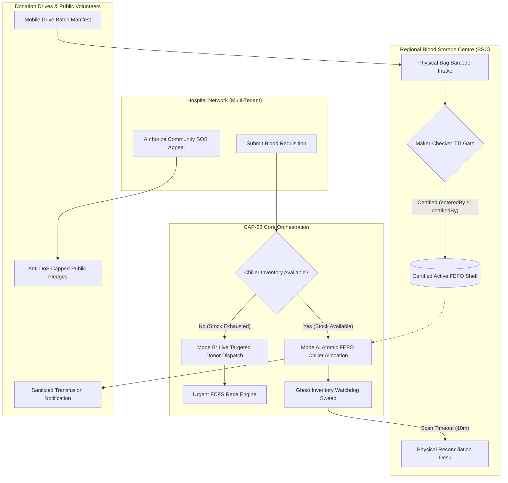

# CAP-23: Autonomous Blood Donation & Transfusion Ecosystem

[](https://www.typescriptlang.org/)
[](https://react.dev/)
[](https://firebase.google.com/)
[](https://tailwindcss.com/)
[](#regulatory-compliance)

An enterprise-grade, clinical transfusion management platform designed to automate blood requisition lifecycle, enforce Maker-Checker transfusion safety gates, optimize First-Expiry-First-Out (FEFO) cold-chain inventory allocation, and coordinate emergency donor mobilization across hospital networks.

---

## 🌟 Architecture & Core Invariants



---

## 🚀 Key Modules & Milestones (M1 – M6)

### 1. Physical Bag Verification & Maker-Checker Gate (Milestone 1)
- **Maker-Checker Quality Principle (DEC-005):** Collected blood bags are initially quarantined. Certification onto the active shelf strictly requires a different certified officer (`enteredBy !== certifiedBy`).
- **30-Minute Return Rule (DGHS §4.2):** Units returned from hospital within 30 minutes with cold chain intact are returned to stock; units exceeding 30 minutes are automatically marked for disposal.
- **Medical Cooldown Engine:** Enforces DGHS/NACO inter-donation intervals (90 days for Whole Blood, 28 days for Platelets/Plasma reciprocal, annual apheresis caps).

### 2. Atomic FEFO Inventory Allocation & Ghost Inventory Guard (Milestone 2)
- **Mode A (Chiller Stock):** Multi-path atomic reservations select the oldest certified units first to minimize expiration and spoilage.
- **Mode B (Live Donor Dispatch):** When inventory is depleted, the system seamlessly triggers targeted donor dispatch.
- **Ghost Inventory Watchdog:** Units reserved but un-scanned after 10 minutes are locked into `ISSUE_UNCONFIRMED` to prevent phantom reservations.
- **Reconciliation Desk:** Physical inspection desk to restore cold-chain verified units or log discarded units.

### 3. Tiered Routine & Urgent Donor Dispatch (Milestone 3)
- **Urgent FCFS Atomic Claiming:** High-concurrency donor claiming engine with double-lock leases and dynamic jitter retry.
- **Standby Donor Pool:** Zero-rejection policy automatically routes overflow donors into a standby pool.
- **Licensed Facility Routing:** Shared routing engine routes donors only to blood banks with active collection licenses.

### 4. Multi-Tenant Hospital Requisition Portal (Milestone 4)
- **Tenant Isolation (AC-SEC-01):** Hospital accounts are cryptographically restricted to their own `hospitalId`.
- **Safe Lifecycle:** Requisitions can only be cancelled while in `Registered` status; once matched or in-transit, medical coordinator confirmation is mandatory.

### 5. Mobile Blood Drives & Bulk Certification (Milestone 5)
- **Batch Transfer Manifests:** Sealed manifests track batch movements from remote camps to regional storage centers.
- **Discrepancy Detection:** Automatic flagging of missing or unexpected barcodes during arrival intake.
- **Chunked Bulk Certification (DEC-015):** Idempotent 50-unit batch certification applying a strict negative-filter invariant—only non-reactive units reach the FEFO shelf.
- **Transfusion Impact Tracker:** Privacy-compliant notifications sent to voluntary donors upon successful transfusion.

### 6. Community SOS Emergency Appeal (Milestone 6)
- **Medical Officer Gate:** Emergency walk-in mobilization requires Medical Officer manual authorization.
- **128-bit Crypto Token:** Generates short-lived, tamper-proof appeal links with a 2-hour TTL.
- **Anti-DoS Volunteer Cap:** Pledges are capped at $3 \times \text{unitsNeeded}$ to prevent facility swarming.
- **Clinical Invariant:** Volunteer pledges **never** decrement clinical demand. Need remains active until units are physically drawn and tested.
- **Privacy Masking:** Donor phone numbers are masked (`98****3211`) in public registries.

---

## 🔒 Regulatory Compliance & Security Matrix

| Standard / Regulation | Enforcement Mechanism |
|---|---|
| **Drugs and Cosmetics Rules 1945 (Schedule F Part XII-B)** | Maker-Checker double verification, mandatory TTI serology, strict quarantine isolation. |
| **DGHS / NBTC Blood Transfusion Guidelines** | Automated component cooldowns, apheresis limits, 30-minute return rule. |
| **Digital Personal Data Protection Act (DPDP) 2023** | Split-node PII isolation, masked donor contact records, zero clinical disclosure in impact alerts. |
| **Motor Vehicles Act § 184** | Silent Transit Shield: zero notification pushes while a donor is marked `EN_ROUTE`. |

---

## 🛠️ Tech Stack & Architecture

- **Frontend:** React 19, TypeScript, Vite 8 (Rolldown engine), TailwindCSS v4, Lucide React
- **Backend:** Firebase Cloud Functions v2 (TypeScript, Node.js 20 runtime)
- **Database:** Firebase Realtime Database (RTDB) with custom security rules matrix
- **Storage:** Cloudinary API for secure medical document & attachment uploads
- **Auth:** Firebase Authentication with Role-Based Access Control (`Admin`, `Manager`, `Storage`, `Hospital`, `Donor`)

---

## 🧪 Comprehensive Verification Suite

The repository contains an automated end-to-end integration and concurrency test suite:

```bash
# Milestone 1: Physical intake, Maker-Checker & 30m Return Rule
node test-milestone1-integration.mjs

# Milestone 2: 20 parallel reservations (Mode A vs Mode B) & Ghost Inventory Guard
node test-fefo-concurrency.mjs
node test-ghost-inventory-fallback.mjs

# Milestone 3: 25 concurrent donors FCFS claiming race
node test-urgent-fcfs-race.mjs

# Milestone 4: Multi-tenant hospital isolation (AC-SEC-01)
node test-hospital-id-isolation.mjs

# Milestone 5: Blood drive batch manifests & negative-filter bulk certification
node test-bulk-manifest-certify.mjs

# Milestone 6: Community SOS emergency appeal & anti-DoS pledge cap
node test-anti-dos-sos-pledge.mjs

# Clinical Rules: 14 DGHS component cooldowns & 192 compatibility permutations
node test-component-cooldowns.mjs
node test-compatibility-parity.mjs

# Security Matrix: RTDB direct client write denial
node test-inventory-direct-write-denied.mjs
```

---

## 💻 Local Setup & Execution

### Prerequisites
- Node.js 20+
- Java 11+ (for Firebase Local Emulator Suite)

### Installation
```bash
# Clone the repository
git clone https://github.com/your-username/cap23-blood-donation.git
cd cap23-blood-donation

# Install dependencies
npm install
npm --prefix functions install
```

### Start Local Emulators & Development Server
```bash
# Terminal 1: Launch Firebase Emulators (Auth, RTDB, Functions)
npx firebase-tools emulators:start --only auth,database,functions

# Terminal 2: Start Vite Dev Server
npm run dev
```

Navigate to `http://localhost:5173` to explore the application locally.
